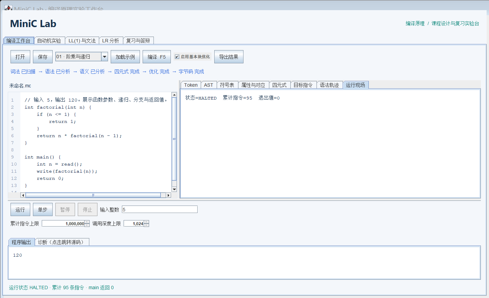
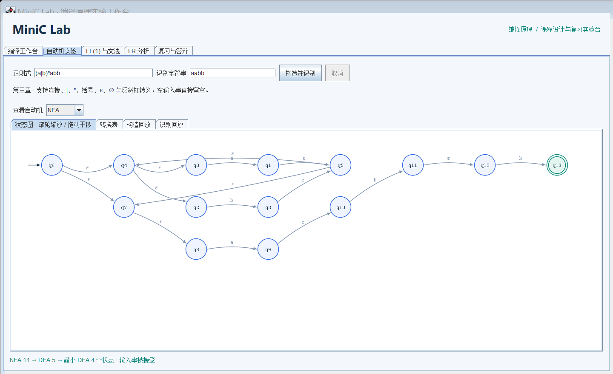

# MiniC Lab

**English** · [简体中文](README.zh-CN.md)

A Java 21 compiler construction project with a Swing desktop workbench, a handwritten MiniC compiler, a stack-based virtual machine, and interactive automata and parsing labs.

Write a small C-like program, inspect each compilation stage, and run or step through the generated bytecode. Use the separate labs to construct automata and compare LL(1), LR(0), SLR(1), and canonical LR(1) parsing.

The desktop interface and detailed course documents are currently in Chinese. Both README versions describe the same implementation.



## Features

| Area | What is implemented |
|---|---|
| Compiler | Lexer, recursive-descent parser, AST, symbol tables, scope/type/definite-assignment checking, quadruple IR, basic-block optimization, and bytecode generation |
| Virtual machine | Independent call frames and operand stacks, recursion, input/output, instruction stepping, pause/resume/stop, and execution limits |
| Automata lab | Thompson construction, NFA-to-DFA subset construction, DFA minimization, state diagrams, transition tables, and recognition traces |
| LL(1) lab | Nullable, FIRST, FOLLOW, SELECT, predictive tables, parsing traces, direct left-recursion elimination, and left factoring |
| LR lab | LR(0), SLR(1), and canonical LR(1) item sets, ACTION/GOTO tables, conflict reporting, and shift/reduce traces |
| Workbench | UTF-8 source files, source-position navigation, compilation exports, eight examples, and bundled learning notes |

All compiler and lab algorithms are handwritten. The application has **no third-party runtime dependencies**; JUnit is used for tests.

## Quick start

Build from source with **JDK 21+** and **Maven 3.9+**. The first build needs network access to download build and test dependencies. The desktop application needs a graphical session.

```sh
git clone https://github.com/MountCoder-merry/minic-lab.git
cd minic-lab
mvn -B verify
java -jar target/minic-lab.jar
```

On Windows, you can also double-click `Start-MiniC.cmd`. It builds the JAR with Maven if the JAR is missing. The PowerShell launcher is available as well:

```powershell
powershell -NoProfile -ExecutionPolicy Bypass -File .\Start-MiniC.ps1
```

The default example is factorial. Click **编译** (Compile), then **运行** (Run). The input field defaults to `5`; the output should be `120`. Use **单步** (Step) and the **运行现场** tab to inspect call frames and local variables.

The repository does not include generated JARs or ZIPs. Once built, running the JAR needs Java 21+ and does not require Maven or a network connection.

## MiniC language

```c
int factorial(int n) {
    if (n <= 1) {
        return 1;
    }
    return n * factorial(n - 1);
}

int main() {
    int n = read();
    write(factorial(n));
    return 0;
}
```

- Types: `int`, `bool`, and `void`; integer and Boolean values do not implicitly convert.
- Statements: local declarations, assignment, blocks, `if/else`, `while`, `break`, `continue`, and `return`.
- Functions: top-level definitions, value parameters, forward calls, recursion, and mutual recursion. The entry point is `int main()`.
- Expressions: arithmetic, comparisons, equality, unary operators, and short-circuit `&&` / `||`.
- Built-ins: `read()` consumes an integer; `write(value)` prints an integer or Boolean on its own line.
- Comments: `//` and non-nested `/* ... */`.

Branch and loop bodies require braces. Locals must be definitely assigned before use. Integer operations follow Java's signed 32-bit behavior; division by zero is a runtime diagnostic. See the [language specification](docs/SPEC.md) for the full EBNF and rules.

This teaching subset excludes floating point, arrays, pointers, global variables, nested functions, `for`, and the C standard library. The backend targets the custom VM; native machine code and SSA generation are outside this version's scope.

## Command line

```sh
java -jar target/minic-lab.jar --help
java -jar target/minic-lab.jar --run examples/factorial.mc --input "5"
java -jar target/minic-lab.jar --run examples/gcd.mc --input "48 18" --no-opt
java -jar target/minic-lab.jar --compile examples/sum.mc
java -jar target/minic-lab.jar --open examples/fibonacci.mc
```

Program output or bytecode goes to stdout. Diagnostics and execution summaries go to stderr. Host exit codes are `0` for success, `1` for argument/file errors, `2` for compilation errors, and `3` for runtime errors. MiniC's `main` return value is displayed separately.

VM limits default to **1,000,000 instructions** and **1,024 call frames**. The desktop lets you change these limits before execution. After a stop or runtime error, running again starts a fresh VM; missing input must be supplied before restarting.

## Interactive labs



| Lab | Try this | Expected result |
|---|---|---|
| Automata | Regex `(a\|b)*abb`, input `aabb` | Accept; minimal DFA has 4 states |
| LL(1) | Default grammar, input `id + id * id` | Accept; inspect FIRST/FOLLOW/SELECT and predictive steps |
| SLR(1) | Default expression grammar | 12 states; accepts the default input |
| LR(1) | Same expression grammar | 22 canonical states; accepts the default input |
| LR(0) | Same expression grammar | Shift/reduce conflicts are reported |

The regex field supports concatenation, `|`, `*`, parentheses, `ε`, `∅`, and backslash escapes. Grammar symbols and parsing input tokens are **space-separated**. Use `ε` alone for an empty production, leave the input field empty for an empty string, and omit the reserved end marker `#`.

Conflicting table cells retain all candidates. The analyzer reports the conflict instead of choosing an action silently. Indirect left recursion is detected; automatic elimination is limited to direct left recursion.

## Examples

| File | Input | Output |
|---|---|---|
| `factorial.mc` | `5` | `120` |
| `fibonacci.mc` | `10` | `55` |
| `gcd.mc` | `48 18` | `6` |
| `sum.mc` | `100` | `5050` |
| `scope-short-circuit.mc` | Empty | `9`, `5`, `false`, `true`, `14` on separate lines |
| `nested-loops.mc` | Empty | `6` |
| `mutual-recursion.mc` | Empty | `true`, `false` on separate lines |
| `errors.mc` | Empty | Compilation fails with six semantic diagnostics |

All examples are in [examples/](examples). Seven are valid programs; the eighth deliberately demonstrates errors.

## Architecture

```text
Source → Tokens → AST → Semantic checks → Quadruple IR
       → Basic-block optimization → Stack bytecode → Virtual machine
```

| Location | Responsibility |
|---|---|
| `src/main/java/edu/minic/core` | Compiler pipeline and VM, independent of Swing |
| `src/main/java/edu/minic/lab` | Automata and grammar/parsing algorithms |
| `src/main/java/edu/minic/ui` | Desktop workbench, diagrams, and trace playback |
| `src/test/java/edu/minic` | Compiler, algorithm, example, and desktop checks |
| `docs` | Specification, design report, course mapping, and verification |

`CompilerService.compile(source, options)` returns stage artifacts and diagnostics. A failed compilation preserves completed stages and produces no executable target. Editing source invalidates the previous executable result.

## Verification and packaging

```sh
mvn -B verify
```

The current suite contains **29 passing tests**, covering valid and invalid programs, recursion, scope, short-circuit evaluation, optimization equivalence, runtime limits, cancellation, and known automata/parsing results.

An optional desktop check opens real Swing windows and drives component events and file dialogs. Run it from Windows PowerShell after compiling tests:

```powershell
java -cp "target/classes;target/test-classes" edu.minic.GuiSmoke target/gui-evidence
```

Desktop checks were performed on Windows 11 at 150% scaling, including a 1024×768 window. Other operating systems and scaling settings have not been verified. See the [verification report](docs/验证报告.md) for evidence and the distinction between Swing event checks and OS mouse automation.

To create a local source-and-runtime delivery ZIP on Windows:

```powershell
powershell -NoProfile -ExecutionPolicy Bypass -File .\Build-Delivery.ps1
```

The script runs verification and creates `dist/MiniC-Lab-1.0.0.zip`, containing the JAR, sources, examples, documentation, and launchers. Build outputs under `target/` and `dist/` remain untracked.

## Documentation

Detailed teaching documents are currently in Chinese:

- [User manual](docs/使用手册.md)
- [Language specification and EBNF](docs/SPEC.md)
- [Architecture](docs/ARCHITECTURE.md)
- [Course design report](docs/课程设计报告.md)
- [Course topic mapping](docs/考点对照表.md)
- [Demo script and source-reading guide](docs/答辩与源码导读.md)
- [Verification report](docs/验证报告.md)
