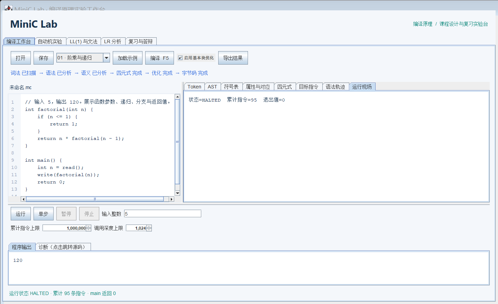
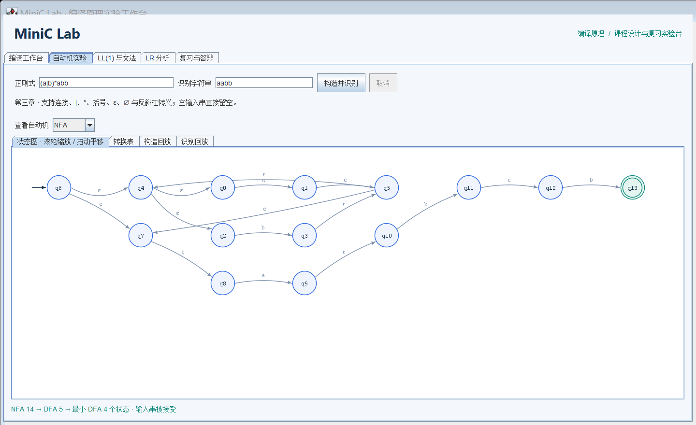

# MiniC Lab

[English](README.md) · **简体中文**

面向编译原理课程设计与期末复习的 **Java 21 桌面实验系统**：手写 MiniC 编译器、自研栈式虚拟机，以及自动机和 LL/LR 语法分析实验台。

输入类 C 程序，查看各编译阶段的真实结果，再运行或单步执行生成的字节码；通过独立实验页构造状态机、分析文法、观察冲突与分析步骤。桌面界面和详细课程文档目前为中文。



## 功能

| 模块 | 已实现内容 |
|---|---|
| 编译器 | 词法分析、递归下降、AST、符号表、作用域/类型/确定赋值检查、四元式、基本块优化、字节码生成 |
| 虚拟机 | 独立调用帧与操作数栈、递归、输入输出、单步、暂停/继续/停止、执行资源限制 |
| 自动机实验 | Thompson NFA、子集法 DFA、分割最小化、状态图、转换表与识别轨迹 |
| LL(1) 实验 | Nullable/FIRST/FOLLOW/SELECT、预测表、分析回放、直接左递归消除与左公因子提取 |
| LR 实验 | LR(0)/SLR(1)/规范 LR(1) 项目集、ACTION/GOTO、冲突报告与移进规约回放 |
| 桌面工作台 | UTF-8 文件读写、源码定位、结果导出、八个内置示例与课程资料 |

编译与实验算法均为手写实现，**运行时没有第三方依赖**；JUnit 仅用于测试。

## 快速开始

从源码构建需要 **JDK 21+、Maven 3.9+**，首次构建需联网下载构建及测试依赖。桌面应用需要可用的图形环境。

```sh
git clone https://github.com/MountCoder-merry/minic-lab.git
cd minic-lab
mvn -B verify
java -jar target/minic-lab.jar
```

Windows 下也可以双击 `Start-MiniC.cmd`。JAR 不存在时，启动脚本会使用 Maven 自动构建。也可使用 PowerShell：

```powershell
powershell -NoProfile -ExecutionPolicy Bypass -File .\Start-MiniC.ps1
```

启动后默认加载阶乘示例。点击 **编译 → 运行**，输入区默认 `5`，预期输出 `120`。点击 **单步**，并切到 **运行现场**，可查看局部变量、操作数栈和递归调用帧。

仓库不提交生成的 JAR 和 ZIP；克隆后需要先构建。构建完成后，运行 JAR 只需要 Java 21+，不需要 Maven 或网络连接。

## MiniC 语言

```c
int factorial(int n) {
    if (n <= 1) {
        return 1;
    }
    return n * factorial(n - 1);
}

int main() {
    int n = read();
    write(factorial(n));
    return 0;
}
```

- 类型：`int`、`bool`、`void`，整数与布尔值不隐式转换。
- 语句：局部声明、赋值、嵌套块、`if/else`、`while`、`break`、`continue`、`return`。
- 函数：顶层定义、值传递参数、前向调用、递归与相互递归；入口为 `int main()`。
- 表达式：算术、比较、相等、一元运算，以及短路 `&&` / `||`。
- 输入输出：`read()` 消费一个整数；`write(value)` 输出一个整数或布尔值并换行。
- 注释：`//` 与非嵌套 `/* ... */`。

分支和循环体必须使用大括号；局部变量读取前必须确定赋值。整数按 Java 32 位有符号运算规则执行，除零在运行时报告。完整 EBNF 和语义见 [SPEC](docs/SPEC.md)。

本版范围不包含浮点、数组、指针、全局变量、嵌套函数、`for` 和 C 标准库。后端目标为自研虚拟机，不生成原生机器码或 SSA。

## 命令行

```sh
java -jar target/minic-lab.jar --help
java -jar target/minic-lab.jar --run examples/factorial.mc --input "5"
java -jar target/minic-lab.jar --run examples/gcd.mc --input "48 18" --no-opt
java -jar target/minic-lab.jar --compile examples/sum.mc
java -jar target/minic-lab.jar --open examples/fibonacci.mc
```

程序输出或字节码写入标准输出，诊断与执行摘要写入标准错误。宿主退出码为：`0` 成功、`1` 参数或文件错误、`2` 编译错误、`3` 运行错误。MiniC `main` 的返回值单独显示。

虚拟机默认限制为 **100 万条累计指令、1024 层调用**，可在桌面运行前调整。暂停不重置预算；停止或运行出错后，再次运行会创建新虚拟机。输入不足时需补足输入后重新运行。

## 复习实验台



| 实验 | 输入或操作 | 预期结果 |
|---|---|---|
| 自动机 | 正则式 `(a\|b)*abb`，字符串 `aabb` | 接受，最小 DFA 有 4 个状态 |
| LL(1) | 默认文法，输入 `id + id * id` | 接受，可查看集合、预测表和分析步骤 |
| SLR(1) | 默认表达式文法 | 12 个状态，接受默认输入 |
| LR(1) | 同一表达式文法 | 22 个规范项目集状态，接受默认输入 |
| LR(0) | 同一表达式文法 | 报告移进/规约冲突 |

正则式支持连接、`|`、`*`、括号、`ε`、`∅` 和反斜杠转义。文法符号与待分析输入都需要**以空格分隔**：`id` 是一个符号，`i d` 是两个。空产生式单独写 `ε`，空输入串留空，不填写保留结束符 `#`。

分析表冲突会保留全部候选式或动作，程序不会静默选择。间接左递归提供检测提示，自动消除仅覆盖直接左递归。

## 内置示例

| 文件 | 输入 | 预期输出 |
|---|---|---|
| `factorial.mc` | `5` | `120` |
| `fibonacci.mc` | `10` | `55` |
| `gcd.mc` | `48 18` | `6` |
| `sum.mc` | `100` | `5050` |
| `scope-short-circuit.mc` | 空 | 逐行输出 `9`、`5`、`false`、`true`、`14` |
| `nested-loops.mc` | 空 | `6` |
| `mutual-recursion.mc` | 空 | 逐行输出 `true`、`false` |
| `errors.mc` | 空 | 编译失败，产生 6 条语义诊断 |

源码均位于 [examples/](examples)。其中七个是正确程序，第八个专门展示错误诊断。

## 架构与源码

```text
源码 → Token → AST → 语义检查 → 四元式
     → 基本块优化 → 栈式字节码 → 虚拟机执行
```

| 路径 | 职责 |
|---|---|
| `src/main/java/edu/minic/core` | 编译链路与虚拟机，不依赖 Swing |
| `src/main/java/edu/minic/lab` | 自动机、文法与语法分析算法 |
| `src/main/java/edu/minic/ui` | 桌面工作台、状态图与步骤回放 |
| `src/test/java/edu/minic` | 编译、算法、示例与桌面检查 |
| `docs` | 规格、设计报告、考点映射与验证记录 |

统一入口为 `CompilerService.compile(source, options)`。结果包含各阶段产物和诊断；编译失败时保留已完成阶段，但不生成可执行目标。修改源码会使旧执行结果失效。

## 验证与打包

```sh
mvn -B verify
```

当前 **29 项自动测试全部通过**，覆盖正确与错误程序、递归、作用域、短路、优化行为一致性、运行资源限制、取消，以及可独立核对的自动机与分析表结果。

桌面检查会实际打开 Swing 窗口，通过控件事件和文件选择器验证功能。编译测试后，在 Windows PowerShell 中运行：

```powershell
java -cp "target/classes;target/test-classes" edu.minic.GuiSmoke target/gui-evidence
```

已在 Windows 11、150% 显示缩放下检查，包含 1024×768 窗口。其他操作系统和缩放档位尚未验证；桌面事件验证与系统鼠标自动化的区别见[验证报告](docs/验证报告.md)。

Windows 下生成本地完整交付包：

```powershell
powershell -NoProfile -ExecutionPolicy Bypass -File .\Build-Delivery.ps1
```

脚本先执行验证，再生成 `dist/MiniC-Lab-1.0.0.zip`，其中包含 JAR、源码、示例、文档和启动脚本。`target/`、`dist/` 为本地构建产物，不提交至仓库。

## 配套文档

- [使用手册](docs/使用手册.md)
- [语言规范与完整 EBNF](docs/SPEC.md)
- [架构说明](docs/ARCHITECTURE.md)
- [课程设计报告](docs/课程设计报告.md)
- [考点对照表](docs/考点对照表.md)
- [答辩演示与源码导读](docs/答辩与源码导读.md)
- [验证报告](docs/验证报告.md)
